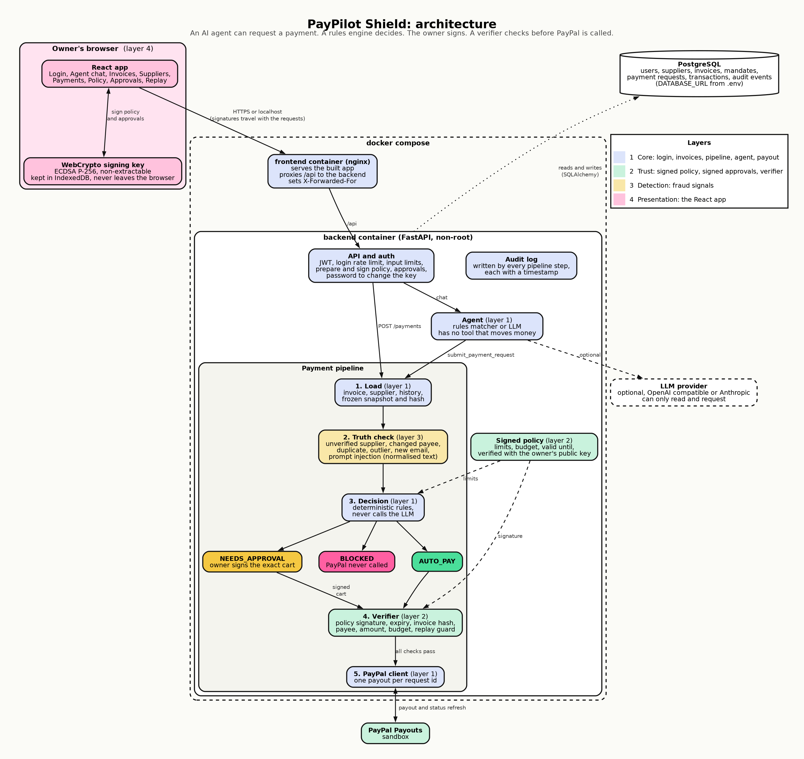

# Architecture

Request pipeline:
1. Agent understands the owner message and calls submit_payment_request
2. Pipeline loads invoice, supplier, history and the active signed policy
3. Truth check produces signals (rules, see layer3.md; an LLM classifier that can only raise risk is planned but not built)
4. Decision: AUTO_PAY, NEEDS_APPROVAL or BLOCKED
5. If NEEDS_APPROVAL, owner signs a cart in the browser
6. Verifier checks policy signature, invoice hash, payee, amount, budget, nonce
7. PayPal client sends the payout (idempotent via sender_batch_id)
8. Status recorded, audit events written
9. Agent explains the outcome in plain language

Deployment: `docker-compose.yml` runs two containers. nginx (frontend) serves the built app and proxies `/api` to the FastAPI backend, which is not published. The database is the `DATABASE_URL` in `.env`. See the README and [security.md](security.md).

The diagram is generated from [architecture.dot](architecture.dot). After editing it, run `dot -Tpng -Gdpi=150 docs/architecture.dot -o docs/architecture.png` (Graphviz).
